# Kepler-7 · Protocolo de Contención

Videojuego de combate táctico por turnos desarrollado en **C# / .NET 8 con Windows Forms** como Trabajo Práctico Final de **Patrones de Diseño (UAI, 2026)**.

Una plaga alienígena tomó la Estación Orbital Kepler-7. El jugador es el Capitán Kael Ortiz y comanda un escuadrón de cuatro contra seis aliens, uno por sector. Cada alien vencido restaura un subsistema de la estación y desbloquea una nueva función. Si el Capitán cae, la misión fracasa. Al vencer al sexto, el Leviatán del Vacío, la campaña termina.

El juego integra los **12 patrones de diseño** pedidos por la consigna. Cada uno resuelve una mecánica concreta y se puede ver mientras se juega.

**Integrantes:** Iñaki Farias · Agustin Quiroz · Bruno Roca

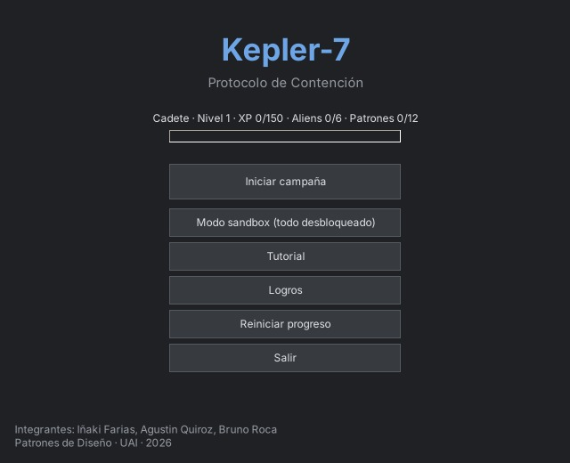

---

## Requisitos del sistema

| | Para ejecutar el juego | Para compilarlo desde el código |
|---|---|---|
| Sistema operativo | Windows 10 o 11 (64 bits) | Windows 10 o 11 (64 bits) |
| .NET | [.NET 8 Desktop Runtime](https://dotnet.microsoft.com/download/dotnet/8.0) | [.NET 8 SDK](https://dotnet.microsoft.com/download/dotnet/8.0) (viene incluido con Visual Studio) |
| IDE | — | Visual Studio 2022 (17.8 o superior) con la carga de trabajo **"Desarrollo de escritorio de .NET"** |
| Pantalla | 1440 × 900 o superior (recomendado 1920 × 1080; la pantalla de combate mide 1360 × 830) | — |

El juego usa solo bibliotecas incluidas en .NET (no tiene paquetes NuGet de terceros) y no necesita base de datos.

---

## Ejecutar el juego compilado (sin Visual Studio)

1. Instalá el **.NET 8 Desktop Runtime** (x64) si no lo tenés.
2. Descomprimí la carpeta de la versión Release.
3. Hacé doble clic en **`Kepler7.exe`**.

---

## Correr el proyecto en Visual Studio

### 1. Clonar el repositorio

Desde Visual Studio: **Archivo → Clonar repositorio…** y pegá la URL:

```
https://github.com/blue00f/tp-final-juego.git
```

O desde una terminal:

```bash
git clone https://github.com/blue00f/tp-final-juego.git
```

### 2. Abrir la solución

Abrí el archivo **`Kepler7.sln`**. En el Explorador de soluciones aparecen dos proyectos:

- **Kepler7.Core**: biblioteca de clases con toda la lógica del juego y los 12 patrones.
- **Kepler7.Game**: aplicación de Windows Forms con la interfaz gráfica.

### 3. Elegir el proyecto de inicio

Hacé clic derecho sobre **Kepler7.Game** y elegí **"Establecer como proyecto de inicio"**.

> Este paso es importante: si queda seleccionado Kepler7.Core, Visual Studio avisa que una biblioteca de clases no se puede iniciar.

### 4. Compilar y ejecutar

- Elegí la configuración **Debug** en la barra superior.
- Presioná **F5**, o **Ctrl + F5** para correr sin depurador.

Visual Studio restaura y compila los dos proyectos y abre la pantalla inicial del juego.

### Alternativa: línea de comandos

Desde la carpeta raíz del repositorio:

```bash
dotnet build Kepler7.sln
dotnet run --project Kepler7.Game
```

---

## Generar el ejecutable en modo Release

**En Visual Studio:** cambiá la configuración de **Debug** a **Release** y usá **Compilar → Compilar solución** (Ctrl + Shift + B). El ejecutable queda en:

```
Kepler7.Game\bin\Release\net8.0-windows\Kepler7.exe
```

Para entregar el juego, copiá **toda** esa carpeta (no solo el `.exe`, porque también necesita `Kepler7.Core.dll` y los archivos de configuración).

**Por línea de comandos:**

```bash
dotnet publish Kepler7.Game -c Release -r win-x64 --self-contained false -o publicacion
```

El resultado queda en la carpeta `publicacion\` y necesita el .NET 8 Desktop Runtime instalado en la computadora donde se ejecute.

> El `.gitignore` excluye las carpetas `bin/` y `Release/`, así que el ejecutable no se sube al repositorio. Se entrega aparte, como `.zip` o como *release* de GitHub.

---

## Progreso guardado

El progreso se guarda automáticamente en archivos JSON (con `System.Text.Json`) en:

```
%AppData%\Kepler7\
```

| Archivo | Contenido |
|---|---|
| `progreso.json` | XP, nivel, aliens derrotados, logros, nave y preparativos |
| `boveda.json` | Archivos de la bóveda de datos (incluye lo que escribe el jugador) |
| `accesos_denegados.json` | Intentos de acceso rechazados por la bóveda |

Para empezar de cero, usá **"Reiniciar progreso"** en la pantalla inicial o borrá esa carpeta.

---

## Cómo se juega

1. **Pantalla inicial:** *Iniciar campaña*, *Modo sandbox* (todo desbloqueado, ideal para probar los patrones), *Tutorial* o *Logros*.
2. **Estación:** antes de cada misión preparás el escuadrón en los módulos que vas desbloqueando (Hangar, Laboratorio, Comunicaciones, Registro y Bóveda). Después tocás **"Iniciar turno y desplegar"**.
3. **Combate:** en tu turno elegís un tripulante y una acción (*Atacar, Curar, Mover, Construir*). Podés **deshacer y rehacer** hasta tocar **"Fin de turno"**. Después actúa el alien según su IA.
4. **Victoria:** derrotar al alien del sector. **Derrota:** que caiga el Capitán.
5. Al vencer a los seis aliens se muestra la pantalla final con el resumen de la campaña y los patrones dominados.

---

## Dónde aparece cada patrón

| Familia | Patrón | Mecánica en el juego | Dónde se ve |
|---|---|---|---|
| Creacional | **Builder** | El Ingeniero Jefe (director) arma naves con distintas recetas (constructores) y planes | Hangar |
| Creacional | **Prototype** | Clonar tripulantes con copia profunda; el clon releva al primer caído | Laboratorio |
| Estructural | **Bridge** | Tipo de mensaje × tipo de cifrado = 9 combinaciones con 6 clases | Comunicaciones |
| Estructural | **Facade** | `ControlCentral` coordina los 6 subsistemas al iniciar el turno y en emergencias | Control Central |
| Estructural | **Flyweight** | 10.000 tripulantes comparten 5 objetos especie | Registro |
| Estructural | **Proxy** | Control de acceso por rol a la bóveda, con registro de rechazos | Bóveda |
| Comportamiento | **Chain of Responsibility** | El daño recorre la cadena Esquiva → Bloqueo → Armadura → Escudo → Vida | Combate |
| Comportamiento | **Command** | Cada acción es un comando: deshacer, rehacer e historial | Combate |
| Comportamiento | **Visitor** | Operaciones sobre el inventario: precio, conteo de armas, aplicar veneno | Combate (Arsenal) |
| Comportamiento | **State** | Normal, Envenenado, Aturdido y Berserk cambian ataque, movimiento y daño recibido | Combate |
| Comportamiento | **Strategy** | IA del alien intercambiable en plena partida (Agresiva, Defensiva, Aleatoria, Calculadora) | Combate |
| Comportamiento | **Template Method** | Esqueleto fijo del turno: inicio, decisión, acción y final | Combate (Turnos) |

---

## Arquitectura

La solución se organiza en capas; cada capa usa solo a las de abajo:

| Capa | Proyecto / carpeta | Responsabilidad |
|---|---|---|
| Presentación | `Kepler7.Game` | Formularios y controles de Windows Forms |
| Aplicación | `Kepler7.Core/Juego` | `Partida` y `Combate` coordinan la partida |
| Mecánicas | `Kepler7.Core/<Patrón>` | Una carpeta por cada uno de los 12 patrones |
| Dominio | `Kepler7.Core/Modelo` | Personaje, MiembroEscuadron, Enemigo |
| Transversal | `Kepler7.Core/Comun`, `Kepler7.Core/Progreso` | Registro de eventos, aleatoriedad, progreso y persistencia |

`Kepler7.Core` no referencia a `System.Windows.Forms`: toda la lógica se puede usar sin la interfaz.

---

## Capturas de pantalla

### Tutorial
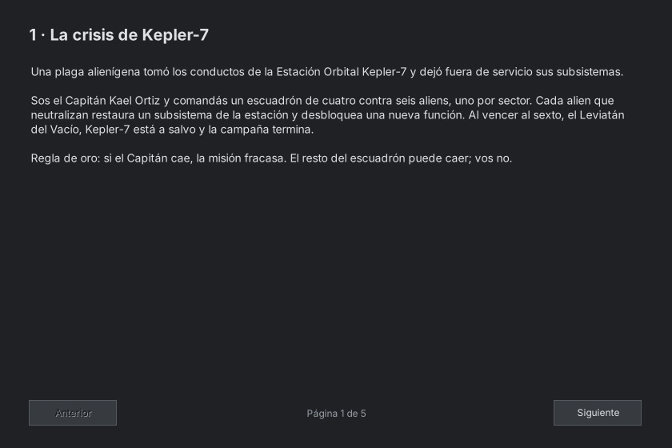

### Estación orbital
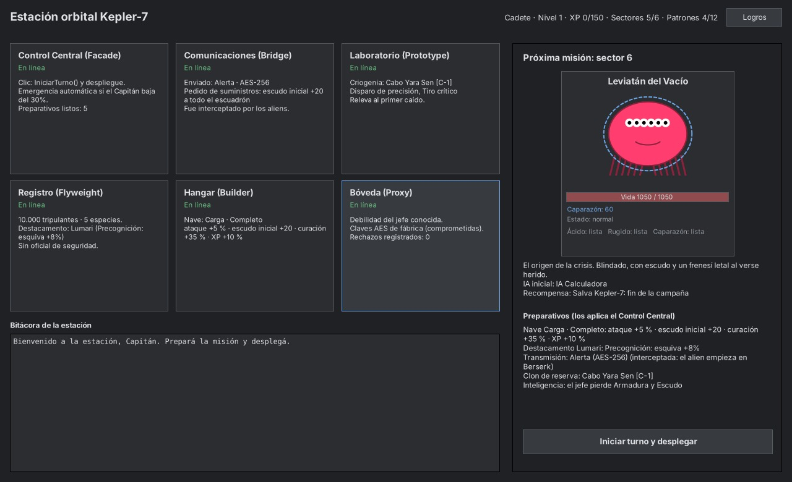

### Control Central (Facade)
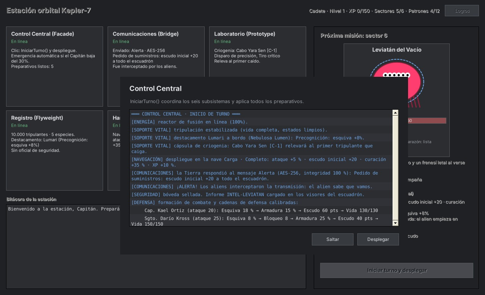

### Combate (Chain of Responsibility, Command, State, Strategy, Template Method, Visitor)
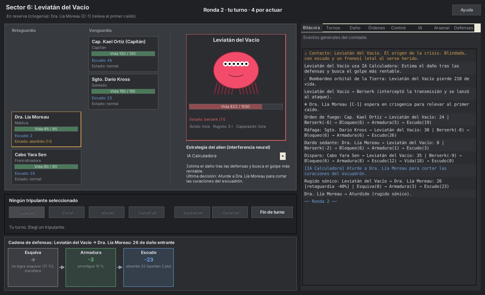

### Hangar de naves (Builder)
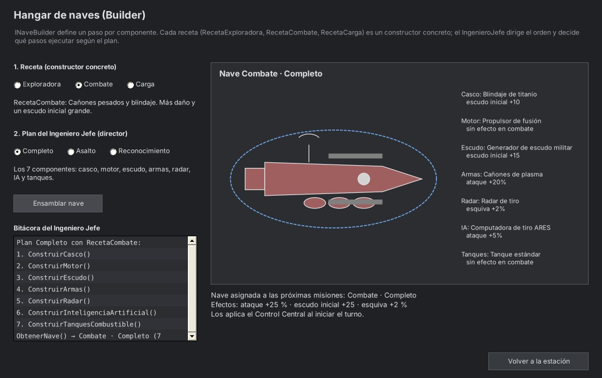

### Laboratorio de biotecnología (Prototype)
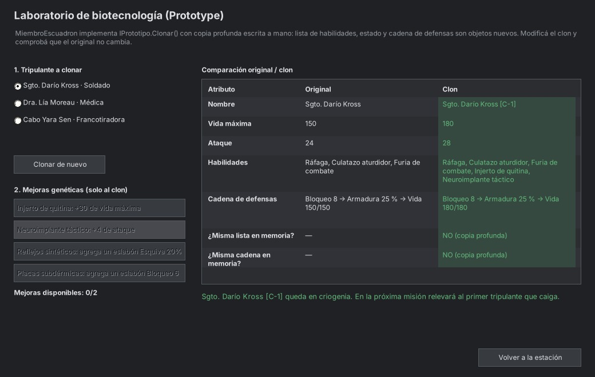

### Comunicaciones con la Tierra (Bridge)
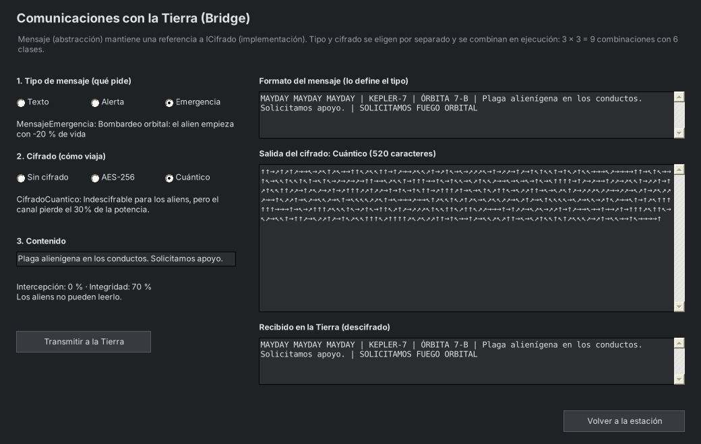

### Registro de tripulación (Flyweight)
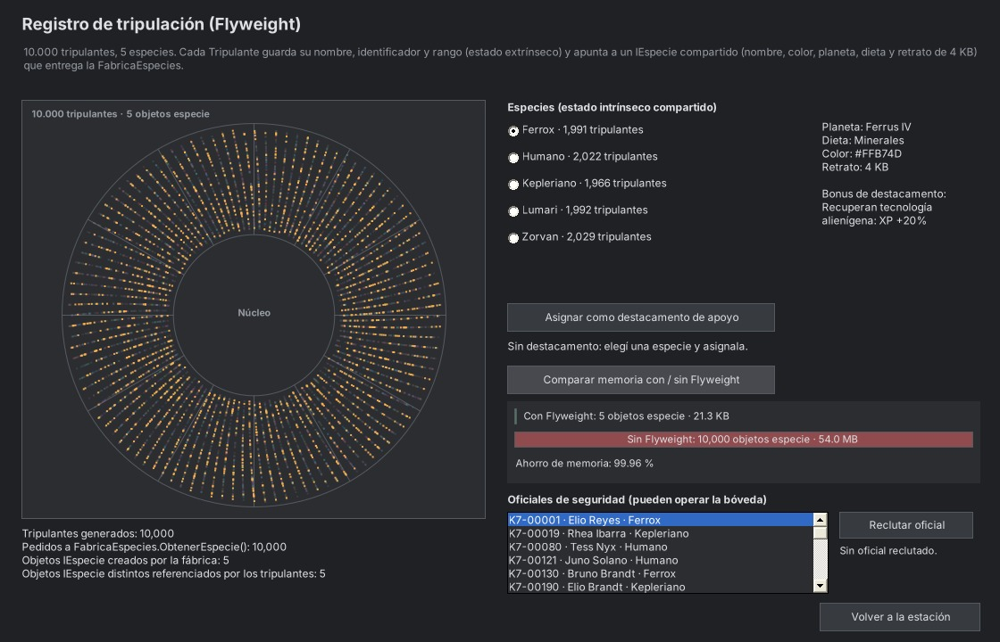

### Bóveda de datos (Proxy)
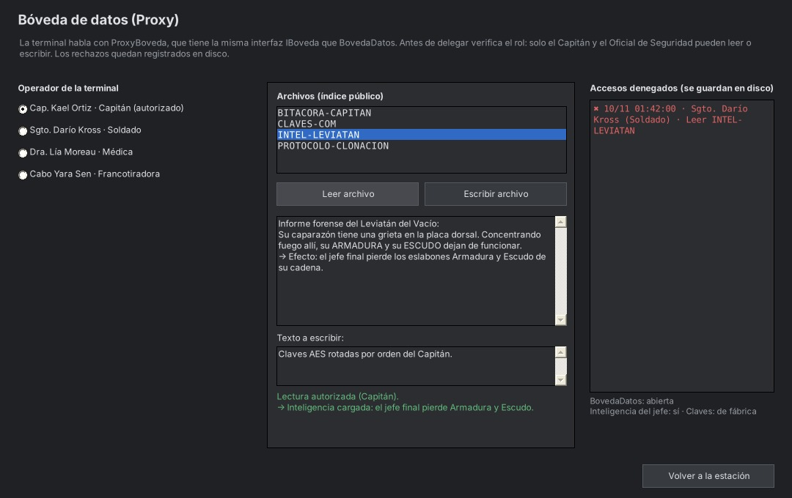

### Pantalla final
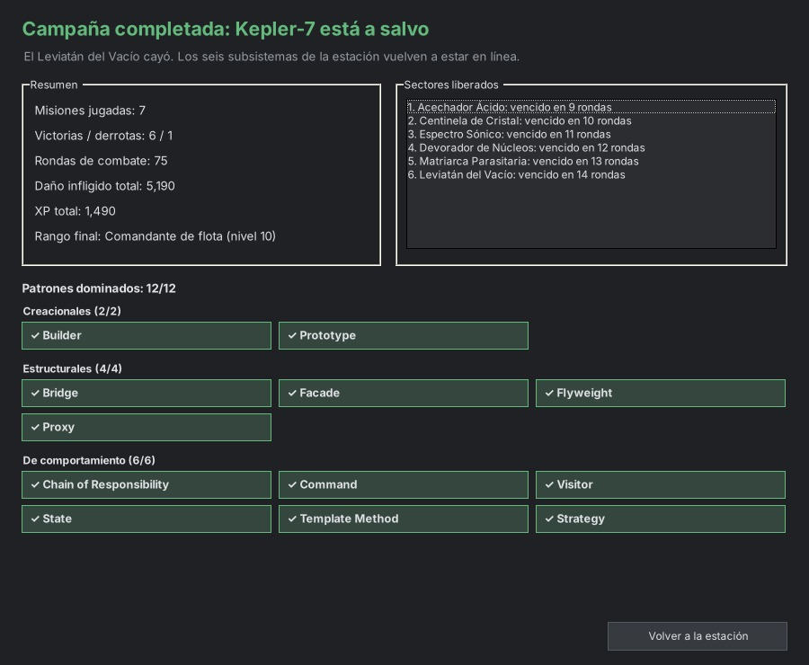
